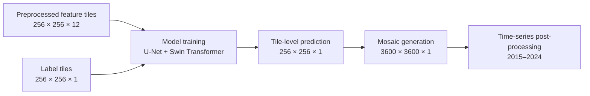

# CAVH1.0

### China’s Annual Vegetation Height Maps, 2015–2024

> **CAVH1.0** provides annual vegetation height maps for China from 2015 to 2024. This repository presents a modular workflow for national-scale vegetation height estimation, including model training, tile-level prediction, mosaic generation, and time-series post-processing.
---

## 🔄 Workflow overview

## 1. Model training

The model combines a U-Net with a Swin Transformer architecture and is implemented in [`U_Swin_Net.py`](U_Swin_Net.py). To support unified height estimation across low-stature vegetation and trees, we employ a **Scale-Distribution Balanced (SDB) loss** that integrates normalized Huber loss with **Label Distribution Smoothing (LDS)**.

The training workflow is implemented in [`trainmodel.py`](trainmodel.py), while the loss function is defined in [`SDB_loss.py`](SDB_loss.py).

### Input data

| Data | Tile dimensions | Description |
|---|---:|---|
| Label tiles | `256 × 256 × 1` | Reference vegetation height |
| Feature tiles | `256 × 256 × 12` | Model input features |

The preprocessed tile paths are stored in text files and read by the training pipeline.

## 2. Prediction and mosaic generation

The trained model is applied using [`predict.py`](predict.py) to generate vegetation height tiles. The predicted tiles are then assembled with [`mosaic.py`](mosaic.py) into larger mosaics.

| Output | Dimensions |
|---|---:|
| Predicted height tile | `256 × 256 × 1` |
| Mosaic tile | `3600 × 3600 × 1` |

## 3. Time-series post-processing

[`Timeseries_processing.py`](Timeseries_processing.py) processes the ten annual mosaics to smooth the temporal variation in the vegetation height estimates.

## 🧰 Requirements

- **Python**
- **PyTorch** — model training and prediction
- **GDAL** — remote-sensing data processing

## 📖 Citation

If you use CAVH1.0 or this code in your research, please cite the associated publication:

> *Citation information to be added.*

---

For implementation details and input/output conventions, please refer to the corresponding scripts.
